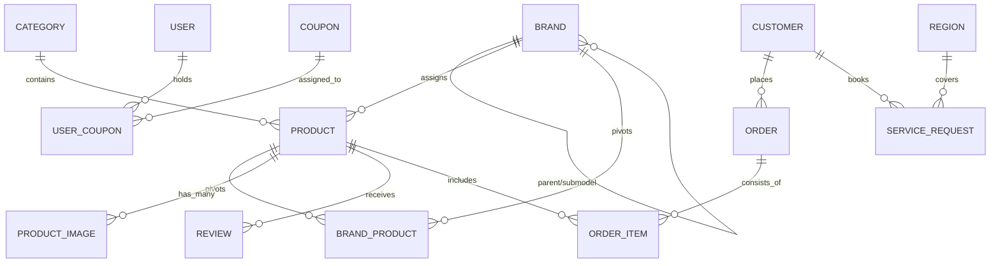
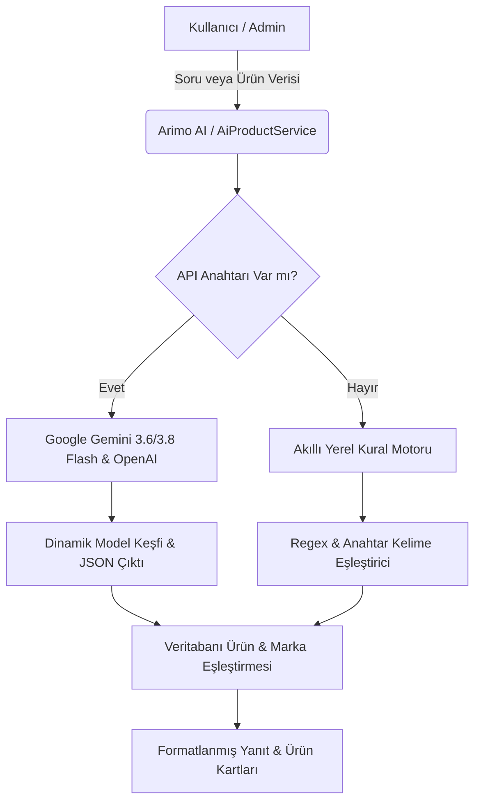

# 💧 İSTANBUL SU ARITMA MARKETİ — KAPSAMLI SİSTEM & TEKNİK MİMARİ REHBERİ
**Sürüm:** 2.5.0 (Ultra Performance, AI Studio & Multi-Brand Edition)  
**Canlı Sistem:** https://istanbulsuaritmamarketi.com  
**Güncelleme Tarihi:** 11 Eylül 2026  

---

## 📑 İÇİNDEKİLER
1. [Genel Bakış ve Teknoloji Yığını](#1-genel-bakış-ve-teknoloji-yığını)
2. [Sistem Mimarisi ve Dizin Ağacı](#2-sistem-mimarisi-ve-dizin-ağacı)
3. [Veritabanı Modelleri ve İlişki Haritası](#3-veritabanı-modelleri-ve-ilişki-haritası)
4. [Tüm Controller'lar ve Sorumluluk Alanları](#4-tüm-controllerlar-ve-sorumluluk-alanları)
5. [Özel Servis Katmanı (Services) ve Arka Plan Motorları](#5-özel-servis-katmanı-services-ve-arka-plan-motorları)
6. [Yapay Zeka (AI) ve Stüdyo Mimarisi](#6-yapay-zeka-ai-ve-stüdyo-mimarisi)
7. [Kullanıcı Arayüzü (Frontend & Blade Bileşenleri)](#7-kullanıcı-arayüzü-frontend--blade-bileşenleri)
8. [Veri Akışları, Webhook'lar ve Tetikleyiciler](#8-veri-akışları-webhooklar-ve-tetikleyiciler)
9. [Admin Yönetim Paneli Modülleri](#9-admin-yönetim-paneli-modülleri)
10. [Canlı Sunucu Dağıtım ve Senkronizasyon Kılavuzu](#10-canlı-sunucu-dağıtım-ve-senkronizasyon-kılavuzu)

---

## 🏢 1. GENEL BAKIŞ VE TEKNOLOJİ YIĞINI

İstanbul Su Arıtma Marketi; yüksek dönüşüm oranlı e-ticaret, çok aşamalı arıtma cihazı/filtre satışı, 39 ilçe montaj & teknik servis randevu yönetimi, interaktif müşteri yakalama araçları ve kurumsal yapay zeka servislerini tek bir çatı altında birleştiren yeni nesil bir Laravel platformudur.

| Katman | Teknoloji / Kütüphane | Kullanım Amacı |
| :--- | :--- | :--- |
| **Backend Çekirdeği** | PHP 8.3 / 8.5 & Laravel 12 | MVC mimarisi, Eloquent ORM, Servis Katmanı, Blade Motoru |
| **Frontend Altyapısı** | TailwindCSS v4, Alpine.js v3, Vite v8 | Modern, reaktif, sıfır gereksiz bağımlılıklı hafif arayüz |
| **Veritabanı** | SQLite (Yerel Test) / MySQL & MariaDB (Canlı) | 42+ Tablo migration'ı, dinamik pivot ilişkiler |
| **Yapay Zeka & Vision** | Google Gemini (3.6 Flash, 3.8 Flash), OpenAI, Pollinations AI | Arimo AI Danışmanı, Gemini Vision ile görsel analizi, DALL-E 3 |
| **Görsel İşleme** | PHP GD Kütüphanesi, Remove.bg API | WebP sıkıştırma, 1:1 e-ticaret tuvali (%88 merkezleme), EXIF düzeltme |
| **Ödeme Altyapısı** | PayTR iFrame 3D Secure API | HMAC-SHA256 imzalı güvenli ödeme ve webhook callback yönetimi |
| **Önbellek & CDN** | Cloudflare Edge Cache, Database/Redis | Statik varlıklar için 1 aylık Edge Cache, anlık sayfa önbellekleme |
| **Tipografi & SEO** | Self-Hosted WOFF2 Figtree Fontları | Harici Google Font zincirini kaldıran sıfır gecikmeli tipografi |

---

## 📁 2. SİSTEM MİMARİSİ VE DİZİN AĞACI

```text
su-aritma-market/
├── app/
│   ├── Http/
│   │   ├── Controllers/
│   │   │   ├── Admin/                           # Yönetim Paneli Controller Grubu
│   │   │   │   ├── ActivityLogController.php    # Superadmin denetim ve aktivite logları
│   │   │   │   ├── BannerController.php         # Ana sayfa ve slider banner yönetimi
│   │   │   │   ├── BrandController.php          # 22+ marka & model yönetimi, ürün senkronizasyonu
│   │   │   │   ├── CategoryController.php       # Kategori CRUD ve görsel yönetimi
│   │   │   │   ├── ContactMessageController.php # İletişim formu mesajları ve okundu takibi
│   │   │   │   ├── CouponController.php         # Yüzdelik & sabit tutarlı indirim kuponları
│   │   │   │   ├── CustomerController.php       # Kayıtlı müşteri rehberi & Excel dışa aktarımı
│   │   │   │   ├── DashboardController.php      # Panel istatistikleri, ciro, sipariş ve servis özetleri
│   │   │   │   ├── FaqController.php            # Sıkça Sorulan Sorular (SSS) yönetimi
│   │   │   │   ├── GiftController.php           # Sepet & cihaz promosyon hediyeleri (TDS, matara vb.)
│   │   │   │   ├── LeadController.php           # Şans çarkı & formlardan toplanan lead kayıtları
│   │   │   │   ├── MaintenanceController.php    # 6 ay / 1 yıl filtre değişim bakım hatırlatıcıları
│   │   │   │   ├── MarketingController.php      # Fırsat sayacı, quiz, çark, hediye, SEO, KVKK ayarları
│   │   │   │   ├── OrderController.php          # Sipariş yönetimi, durum güncelleme, WhatsApp fişi, Excel
│   │   │   │   ├── PageController.php           # Kurumsal statik sayfalar (KVKK, İptal/İade, Hakkımızda)
│   │   │   │   ├── PostController.php           # Blog makaleleri, URL kazıma ve AI ile makale üretimi
│   │   │   │   ├── ProductController.php        # Zengin ürün yönetimi, AI stüdyo, URL kazıma, Excel içe aktar
│   │   │   │   ├── RegionController.php         # 39 İlçe servis bölgeleri ve özel açıklamalar
│   │   │   │   ├── ReviewController.php         # Müşteri yorum onay/red yönetimi
│   │   │   │   ├── ServiceRequestController.php # Teknik servis, montaj randevuları, takvim, çöp kutusu, fiş
│   │   │   │   ├── SettingController.php        # Logo, favicon, telefon, adres, API anahtarları
│   │   │   │   ├── TestimonialController.php    # Müşteri deneyimleri ve referans vitrini
│   │   │   │   └── UserController.php           # Yönetici ve yetkili personel kullanıcı hesapları
│   │   │   │
│   │   │   ├── Auth/                            # Laravel Breeze Kimlik Doğrulama Controller'ları
│   │   │   ├── ArimoController.php              # 🤖 Arimo AI Su Arıtma Danışmanı ve Akıllı Kural Motoru
│   │   │   ├── BlogController.php               # Blog listeleme, detay ve makale içi arama
│   │   │   ├── CartController.php               # Sepet yönetimi, kupon indirimi, hediye seçimi, checkout
│   │   │   ├── CookieConsentController.php      # KVKK çerez onay loglarını toplayan yasal uç nokta
│   │   │   ├── CustomerController.php           # Müşteri profil paneli (/hesabim), kupon ve sipariş geçmişi
│   │   │   ├── DistrictController.php           # 39 İlçe SEO açılış sayfaları (/istanbul-su-aritma/{ilce})
│   │   │   ├── FeedController.php               # Google Merchant Center (Google Alışveriş) XML akışı
│   │   │   ├── FrontendController.php           # Kategori, ürün detay, marka vitrini, statik sayfalar, iletişim
│   │   │   ├── HomeController.php               # Ana sayfa: vitrinler, fırsat sayacı, popüler kategoriler
│   │   │   ├── LeadController.php               # Şans çarkı & kampanya AJAX lead toplama endpoint'i
│   │   │   ├── PayTRController.php              # PayTR Webhook callback endpoint'i & ödeme hata sayfası
│   │   │   ├── ProductController.php            # Genel ürün kataloğu, filtreleme, arama ve sıralama
│   │   │   ├── ProfileController.php            # Kullanıcı hesap profili düzenleme
│   │   │   ├── ReviewController.php             # Ürünlere müşteri yorumu ve yıldız gönderme
│   │   │   ├── ServiceController.php            # Müşteri montaj/bakım talep formu (/servis-talebi)
│   │   │   └── SitemapController.php            # Dinamik XML Site Haritası ve Robots.txt
│   │   │
│   │   └── Middleware/
│   │       └── IsAdmin.php                      # Admin paneli giriş ve yetki denetimi
│   │
│   ├── Models/                                  # Eloquent Veritabanı Modelleri (26 Model)
│   │   ├── ActivityLog.php                      # Superadmin işlem hareket kayıtları
│   │   ├── Banner.php                           # Slayt ve görsel afişler
│   │   ├── Brand.php                            # Marka modeli (Parent/Child hiyerarşisi destekli)
│   │   ├── Category.php                         # Kategori modeli ve kapak görselleri
│   │   ├── ContactMessage.php                   # İletişim formu mesajları
│   │   ├── CookieConsent.php                    # KVKK IP, User-Agent, zaman damgalı rıza kaydı
│   │   ├── Coupon.php                           # İndirim kuponları
│   │   ├── Customer.php                         # Müşteri dizini
│   │   ├── Faq.php                              # SSS öğeleri
│   │   ├── Gift.php                             # Promosyon hediyeleri
│   │   ├── Lead.php                             # Potansiyel müşteri adayları
│   │   ├── Order.php & OrderItem.php            # Sipariş ve sipariş kalemleri
│   │   ├── Page.php                             # Statik kurumsal sayfalar
│   │   ├── Post.php                             # Blog yazıları
│   │   ├── Product.php & ProductImage.php       # Ürün modeli ve çoklu galeri resimleri
│   │   ├── Region.php                           # İstanbul ilçe bilgileri
│   │   ├── RenovationLead.php & Project.php     # Mutfak/banyo ve arıtma tadilat projeleri
│   │   ├── Review.php                           # Ürün müşteri yorumları
│   │   ├── ServiceRequest.php                   # Servis & montaj talepleri (SoftDelete destekli)
│   │   ├── Setting.php                          # Key-Value formatında dinamik konfigürasyonlar
│   │   ├── Testimonial.php                      # Müşteri referansları
│   │   └── User.php & UserCoupon.php            # Kullanıcılar ve kullanıcıya tanımlı kuponlar
│   │
│   └── Services/                                # Çekirdek İş Mantığı ve Harici Servis Entegrasyonları
│       ├── AiBlogService.php                    # AI destekli blog makalesi yazımı ve başlık üretimi
│       ├── AiProductService.php                 # AI metin yazarı, Gemini Vision stüdyo, 1:1 e-ticaret tuvali
│       ├── ArticleScraperService.php            # Harici blog URL'lerinden makale kazıma motoru
│       ├── ImageOptimizerService.php            # Otomatik WebP dönüştürücü ve toplu görsel sıkıştırma
│       ├── PayTRService.php                     # PayTR HMAC-SHA256 imzalama, token alma ve doğrulama
│       └── ProductScraperService.php            # Trendyol, Hepsiburada vb. ürün URL'lerinden veri kazıma
│
├── database/
│   ├── migrations/                              # 42 Adet şema migration dosyası
│   └── seeders/
│       ├── BrandSeeder.php                      # 22 Su arıtma markası ve alt modelleri seeder'ı
│       ├── CouponSeeder.php                     # Çark ve kampanya indirim kuponları
│       └── DatabaseSeeder.php                   # Başlangıç test ve demo verileri
│
├── resources/
│   ├── views/
│   │   ├── admin/                               # 22 Alt klasörde eksiksiz admin yönetim arayüzleri
│   │   ├── blog/                                # Blog index ve detay sayfaları
│   │   ├── cart/                                # Sepet, checkout ve sipariş başarı ekranları
│   │   ├── components/                          # Tekrar kullanılabilir Blade bileşenleri (Çark, Sihirbaz vb.)
│   │   ├── customer/                            # Müşteri hesap paneli ekranları
│   │   ├── layouts/                             # Admin ve Frontend ana iskelet şablonları
│   │   ├── arimo.blade.php                      # Arimo AI Asistanı bağımsız sohbet sayfası
│   │   ├── brand.blade.php                      # Marka özel vitrin sayfası (Örn: İhlas Uyumlu Filtreler)
│   │   ├── calculator.blade.php                 # Damacana vs Arıtma Tasarruf Hesaplayıcısı
│   │   ├── filter-finder.blade.php              # Uyumlu filtre seçim aracı
│   │   ├── product.blade.php                    # Ürün detay sayfası (Dokunmatik slider, hediye vitrini, SSS)
│   │   ├── products.blade.php                   # Ürün listeleme kataloğu ve filtreleme
│   │   ├── service-request.blade.php            # Servis talep oluşturma sayfası
│   │   ├── track-order.blade.php                # Canlı sipariş ve servis takip sorgulama ekranı
│   │   ├── welcome.blade.php                    # Ana sayfa
│   │   └── wizard.blade.php                     # 3-4 Adımlı Cihaz Bulucu Sihirbazı
│   ├── css/app.css                              # Tailwind CSS v4 stilleri
│   └── js/app.js                                # Alpine.js ve arayüz etkileşim betikleri
│
└── routes/
    ├── web.php                                  # Tüm genel ve admin web rotaları (182 satır)
    └── auth.php                                 # Breeze kimlik doğrulama rotaları
```

---

## 🗄️ 3. VERİTABANI MODELLERİ VE İLİŞKİ HARİTASI



### Öne Çıkan Tablo & Model Yetenekleri
* **`Product`**: `price`, `campaign_price`, `stock`, `is_active`, `is_featured`, `badges` (JSON dizi), `short_description`, `technical_features`, `seo_title`, `seo_description`, `discount_percent` (otomatik sanal özellik).
* **`Brand`**: Hiyerarşik yapı (`parent_id`). Örneğin `İhlas` ana marka, `Aura Cebilon Plus` alt modeldir. `brand_product` pivot tablosu sayesinde bir filtre birden fazla markayla eşleşebilir.
* **`ServiceRequest`**: Montaj, filtre bakımı ve arıza talepleri. `SoftDeletes` korumalıdır; teknisyen notu, servis ücreti, ödeme şekli ve takvim randevu tarihi içerir.
* **`CookieConsent`**: KVKK açık rıza denetimi için yasal kanıt tablosu. `consent_token`, `ip_address`, `user_agent`, `categories` (Zorunlu, Analitik, Pazarlama).
* **`Lead`**: Şans çarkı ve hızlı teklif formlarından toplanan potansiyel müşteriler (`name`, `phone`, `district`, `source`, `coupon_code`).

---

## 🎮 4. TÜM CONTROLLER'LAR VE SORUMLULUK ALANLARI

### Genel (Frontend) Controller Grubu
1. **`HomeController`**: Ana sayfa yüklemesi; aktif banner'lar, günün fırsatı sayacı, öne çıkan kategoriler ve en çok satan cihazlar.
2. **`FrontendController`**: 
   - Kategori listesi ve detay filtrelemesi (`category.show`).
   - Ürün detay sayfası (`product.show`) ve dinamik hediye seçeneklerinin getirilmesi.
   - Marka vitrini (`brand.show`) ve filtre bulucu (`filter.finder`).
   - Damacana tasarruf hesaplayıcısı ve cihaz sihirbazı görünümleri.
   - Sipariş ve servis canlı takip sorgusu (`order.track`).
3. **`ArimoController`**:
   - `/arimo` bağımsız asistan sayfası.
   - `/arimo/ask` AJAX uç noktası: Kullanıcı mesajını alır, önce Gemini / OpenAI API anahtarlarıyla LLM çağrısı yapar; API yoksa veya başarısız olursa akıllı yerel kural motorunu (`smartLocalAssistant`) devreye sokar.
4. **`CartController`**:
   - Sepete ekleme, adet güncelleme, sepetten silme, kupon kodu uygulama/kaldırma.
   - Checkout adımı: İlçe seçimi, seçilen ücretsiz hediye (`selected_gift`), fatura/teslimat adresi ve ödeme yöntemi seçimi.
5. **`PayTRController`**:
   - PayTR'ın 3D Secure işleminden sonra sunucuya attığı POST webhook bildirimini karşılar (`/paytr/callback`).
   - HMAC-SHA256 imzasını ve tutarı kuruşu kuruşuna doğrular.
   - Başarısız işlemlerde müşteriyi `/odeme/hata/{order_number}` sayfasına yönlendirir.
6. **`DistrictController`**: İstanbul'un 39 ilçesi için özel SEO landing sayfaları sunar (`/istanbul-su-aritma/kadikoy` vb.).
7. **`BlogController`**: Su arıtma rehberleri, filtre değişim kılavuzları ve canlı arama.
8. **`CustomerController`**: Giriş yapan müşterilerin siparişlerini izlediği, profilini güncellediği ve kazandığı kuponları uyguladığı `/hesabim` paneli.

### Yönetim Paneli (Admin) Controller Grubu
1. **`Admin\ProductController`**: Quill.js Word editörü ile ürün yönetimi, URL'den otomatik ürün çekme (`scrapeUrl`), yapay zeka ile yeniden yazma (`aiRewrite`), Gemini Vision stüdyosu (`aiEditStudio`), toplu Excel içe/dışa aktarımı.
2. **`Admin\ServiceRequestController`**: Gelen servis ve montaj taleplerinin atanması, servis yazdırma fişi (`orders.print`), takvim görünümü (`services/calendar`), Excel export ve çöp kutusu (Trash / Restore / Force Delete).
3. **`Admin\MaintenanceController`**: 6 ayı veya 1 yılı dolan geçmiş servislerin periyodik filtre değişim zamanlarını filtreler; tek tıkla yeni servis talebine dönüştürür (`maintenance.renew`).
4. **`Admin\MarketingController`**: Günün fırsatı sayacı, Akıllı Cihaz Bulucu Quiz adımları, Şans Çarkı dilim/ödül yönetimi, PayTR API ayarları, SEO/Meta etiketleri, KVKK çerez logları ve Performans/Önbellek temizleme merkezi.
5. **`Admin\BrandController`**: 22+ su arıtma markasını listeleme, yeni marka/alt model ekleme ve ürünlerle toplu senkronize etme (`brands.products.sync`).

---

## ⚙️ 5. ÖZEL SERVİS KATMANI (SERVICES) VE ARKA PLAN MOTORLARI

### 1. `AiProductService.php` (Ürün Zekası & Stüdyo Motoru)
* **`repairGluedText(string $text)`**: Web kazıyıcılarından veya rakiplerden kopyalanan metinlerdeki yapışık kelimeleri (`"uygundur.Saatlik"` ➔ `"uygundur. Saatlik"`), bozuk etiket boşluklarını ve rakip pazar yeri adlarını (Trendyol, Hepsiburada vb.) regex ile onarır.
* **`rewriteProduct(array $data, ...)`**: Ham veriyi Google Gemini veya OpenAI'a göndererek temiz HTML paragraflı, aşama aşama ayrılmış filtre açıklamalı kurumsal ürün içeriğine dönüştürür.
* **`smartRuleBasedRewrite(...)`**: API anahtarı olmadan veya internet kesintisinde çalışan yerel kural motorudur. Metindeki 5 mikron, CTO, membran, tank gibi kelimeleri otomatik ayıklayıp kutu içeriği ve teknik özellik listesi üretir.
* **`reimagineImage(...)`**: Yüklenen ham bir ürün fotoğrafını Gemini Multimodal Vision ile inceler; arka planı, filigranları ve kirli mutfak görüntülerini yok sayarak stüdyo promptu oluşturur ve Pollinations AI / DALL-E 3 ile yeniden üretir.
* **`formatToEcommerceWhiteBackground(...)`**: Remove.bg API veya yerel GD kütüphanesiyle görseli 1000x1000 saf beyaz tuvale yerleştirir ve ürünü tam %88 oranında merkeze oturtur.

### 2. `ImageOptimizerService.php` (Görsel Sıkıştırma & Hız Motoru)
* Admin panelinden yüklenen devasa 5-10 MB'lık fotoğrafları anında WebP formatına dönüştürür.
* Kalite kaybı olmadan %95'e varan dosya boyutu tasarrufu sağlar.
* `/admin/marketing/performance` sayfasından eski tüm görselleri tek tıkla tarayıp optimize eden toplu motor içerir.

### 3. `PayTRService.php` (Ödeme Güvenlik Motoru)
* PayTR API entegrasyonu için gerekli sepet dizisini hazırlar.
* `merchant_id`, `user_ip`, `merchant_oid`, `email`, `payment_amount`, `merchant_salt` ve `merchant_key` parametrelerini birleştirip **HMAC-SHA256** algoritmasıyla base64 hash imzası üretir.
* Webhook bildiriminde gelen hash ile yerel hash'i karşılaştırarak yetkisiz sahte ödeme bildirimlerini engeller.

### 4. `ProductScraperService.php` & `ArticleScraperService.php` (Veri Kazıma)
* Girdi olarak verilen bir ürün veya blog linkinin HTML DOM yapısını tarar.
* Başlık, fiyat, açıklama, teknik özellikler ve ürün görsellerini CDN hotlink engellerini aşarak (Brotli/Gzip ve User-Agent taklidiyle) çeker ve yerel storage'a kaydeder.

---

## 🤖 6. YAPAY ZEKA (AI) VE STÜDYO MİMARİSİ



### Arimo Yapay Zeka Asistanı Yetenekleri
* **Satış Odaklı Tavsiye:** Ailedeki kişi sayısına, dairenin katına (pompalı vs pompasız) ve şebeke kireç oranına göre nokta atışı cihaz önerir.
* **Filtre Değişim Rehberliği:** Hangi filtrenin kaç ayda bir değişmesi gerektiğini (Sediment 6 ay, Membran 2 yıl vb.) ve uyumlu filtre setini sunar.
* **Dinamik Model Keşfi:** Gemini 1.5 veya eski modeller kapandığında sistem otomatik olarak Google API'den açık olan en güncel `gemini-3.x` modellerini bulup sorguyu başarıyla tamamlar.

---

## 🎨 7. KULLANICI ARAYÜZÜ (FRONTEND & BLADE BİLEŞENLERİ)

* `<x-frontend-layout>`: Tüm sitenin ortak header, mega arama çubuğu, sepet sayacı, WhatsApp hızlı destek butonu ve footer iskeleti.
* `<x-lucky-wheel>`: Sayfada 12 saniye sonra açılan, Ad/Telefon/İlçe alarak kupon veren ve `localStorage` ile ikinci kez rahatsız etmeyen Şans Çarkı.
* `<x-gift-selector>`: Sepet ve ödeme ekranında müşterinin 0 TL karşılığında Matara, Termos, TDS Ölçer veya Oyuncak seçmesini sağlayan interaktif hediye paneli.
* `<x-quiz-wizard>`: Kullanıcıya 3 soru sorarak (Ev/İşyeri, Kişi Sayısı, Basınç Durumu) en ideal cihazı eşleştiren sihirbaz.
* `<x-savings-calculator>`: Haftalık tüketilen damacana adedini alıp yıllık 15.000+ TL tasarruf tablosunu canlı grafiklerle gösteren modül.
* `<x-cookie-banner>`: KVKK zorunlu, analitik ve pazarlama çerezlerini yöneten ve kararları veritabanına loglayan rıza banner'ı.

---

## 🔄 8. VERİ AKIŞLARI, WEBHOOK'LAR VE TETİKLEYİCİLER

### A. PayTR 3D Secure Ödeme Akışı
1. Müşteri sepette *"Kredi Kartı"* seçer ve sipariş oluşturulur (`status = 'pending'`).
2. `PayTRService` üzerinden alınan token ile PayTR iFrame açılır.
3. Müşteri 3D Secure SMS kodunu doğrular.
4. PayTR sunucusu `https://istanbulsuaritmamarketi.com/paytr/callback` adresine POST isteği gönderir (`bootstrap/app.php` içinde CSRF doğrulamasından muaftır).
5. Sipariş durumu `processing` (Ödeme Alındı) yapılır ve müşteriye teşekkür ekranı gösterilir.

### B. Lead (Müşteri Adayı) Yakalama Akışı
1. Şans Çarkı çevrildiğinde veya teklif formu doldurulduğunda `/leads` rotasına AJAX POST atılır.
2. `Lead` tablosuna isim, telefon, ilçe ve kazanılan kupon kaydedilir.
3. Admin panelindeki **Müşteri Adayları** menüsüne anında düşer ve tek tıkla WhatsApp görüşmesi başlatılabilir.

### C. Teknik Servis & Periyodik Bakım Akışı
1. Müşteri `/servis-talebi` sayfasından randevu oluşturur.
2. Talep Admin **Servis Talepleri** paneline ve servis takvimine (`/admin/services/calendar`) işlenir.
3. Servis tamamlandığında durumu *"Tamamlandı"* yapılır.
4. Aradan 6 ay veya 1 yıl geçtiğinde sistem bu kaydı otomatik olarak `/admin/maintenance` (Bakım Hatırlatıcıları) listesine taşır.

---

## 🛠️ 9. ADMİN YÖNETİM PANELİ MODÜLLERİ

| Modül | URL | Yetenekler |
| :--- | :--- | :--- |
| **Dashboard** | `/dashboard` | Ciro, sipariş sayıları, bekleyen servisler, son leadler ve hızlı kısayollar. |
| **Ürünler** | `/admin/products` | Quill editör, AI yeniden yazıcı, Gemini Vision stüdyosu, Excel içe/dışa aktarım. |
| **Markalar** | `/admin/brands` | 22 Marka ve alt modelleri, çoklu filtre-cihaz ürün eşleştirme senkronizasyonu. |
| **Siparişler** | `/admin/orders` | Durum değiştirme, kargo takip no girme, tek tıkla WhatsApp sipariş fişi çıkarma. |
| **Servisler** | `/admin/services` | Montaj randevuları, servis fişi yazdırma, takvim görünümü, Excel aktarımı, çöp kutusu. |
| **Bakım Takibi** | `/admin/maintenance` | Filtre değişim zamanı gelen eski müşteriler ve tek tıkla yeni randevu açma. |
| **Blog & İçerik** | `/admin/posts` | SEO makaleleri, URL kazıma ile rakip analizli AI makale üretimi. |
| **Pazarlama / Çark** | `/admin/marketing/wheel` | 6 Dilimli şans çarkı ödülleri, kuponları ve kazanma oranları. |
| **Pazarlama / Hediye** | `/admin/marketing/gifts` | Sepette ücretsiz sunulan promosyon hediyelerinin tanımlanması. |
| **SEO & Analitik** | `/admin/marketing/seo` | GTM, GA4, Meta Pixel, Merchant Center XML linki ve Google site doğrulama kodları. |
| **Performans** | `/admin/marketing/performance` | Tek tıkla WebP görsel dönüştürücü ve Laravel önbellek sıfırlama motoru. |
| **KVKK Kayıtları** | `/admin/marketing/cookie-consents` | Zaman damgalı, IP ve tarayıcı kayıtlı yasal çerez izin kütüğü (Excel çıktılı). |
| **Ayarlar** | `/admin/settings` | Logo, Favicon, Sabit Tel, WhatsApp hattı, Gemini/OpenAI/RemoveBG API anahtarları. |

---

## 🚀 10. CANLI SUNUCU DAĞITIM VE SENKRONİZASYON KILAVUZU

Proje, Cenuta cPanel sunucusunda güvenli **Çift Dizin (Dual Directory)** mimarisiyle çalışır:
* **`/home/istanbul30/laravel_core`**: Kaynak kodlar, PHP sınıfları, view'lar ve gizli `.env` dosyası.
* **`/home/istanbul30/public_html`**: Dışarıya açık derlenmiş varlıklar (`build/`), fotoğraflar (`storage/`), yerel fontlar (`fonts/`), `.htaccess` ve `index.php`.

### Adım 1: Yerel Bilgisayarda (Laragon) Değişiklikleri Gönderme
```powershell
cd C:\laragon\www\su-aritma-market

# Frontend varlıklarını üretim için derle
npm run build

# Git'e ekle ve GitHub'a gönder
git add .
git commit -m "feat: enhance system and update documentation"
git push origin main
```

### Adım 2: Cenuta cPanel SSH Terminalinde Güncelleme
```bash
# 1. Çekirdek dizine geç ve kodları çek
cd /home/istanbul30/laravel_core
git pull origin main

# 2. Varsa yeni veritabanı tablolarını migrate et
php artisan migrate --force

# 3. Derlenmiş Vite dosyalarını public_html'e kopyala
rm -rf /home/istanbul30/public_html/build
cp -r public/build /home/istanbul30/public_html/

# 4. Güncel .htaccess ve fontları kopyala
cp public/.htaccess /home/istanbul30/public_html/
mkdir -p /home/istanbul30/public_html/fonts
cp -r public/fonts/* /home/istanbul30/public_html/fonts/

# 5. Tüm önbellekleri sıfırla ve yeniden optimize et
php artisan optimize:clear
php artisan config:cache
php artisan route:cache
php artisan view:cache
```

---
*İstanbul Su Arıtma Marketi — Yüksek Performanslı Özel E-Ticaret ve CRM Ekosistemi*